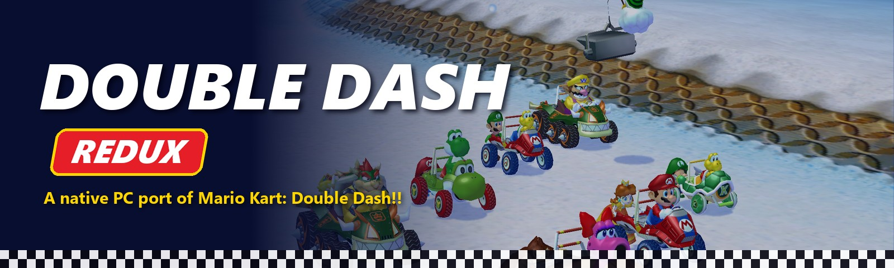
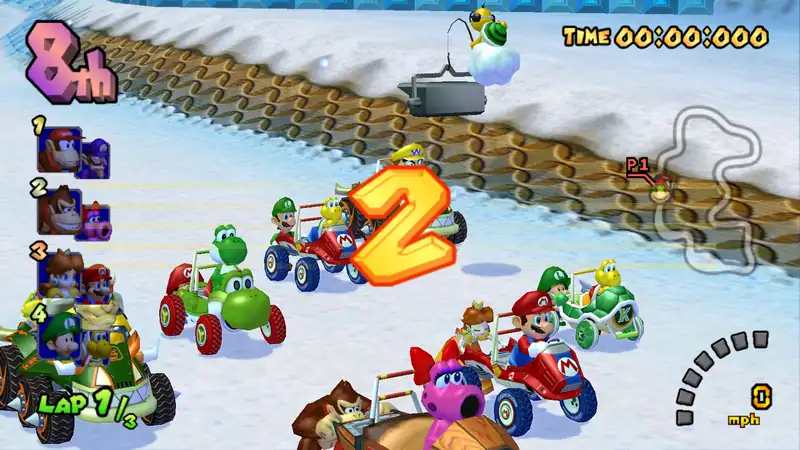
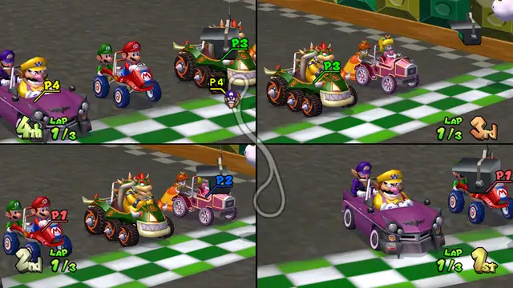
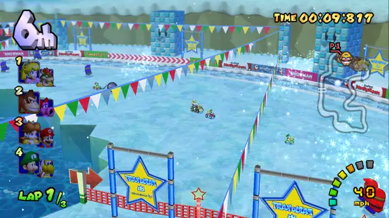
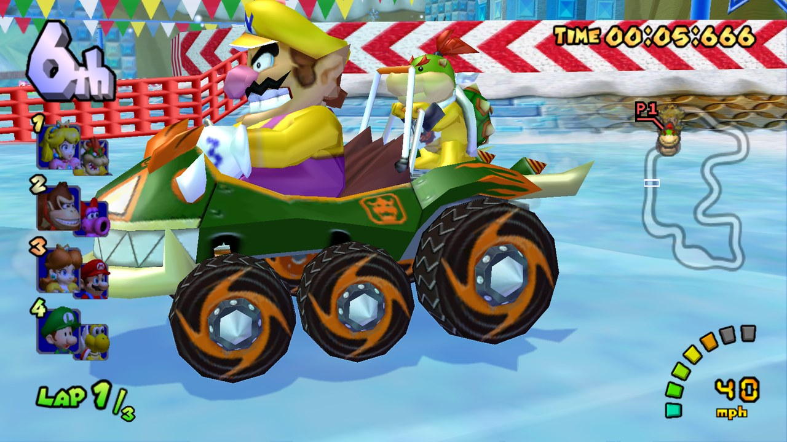
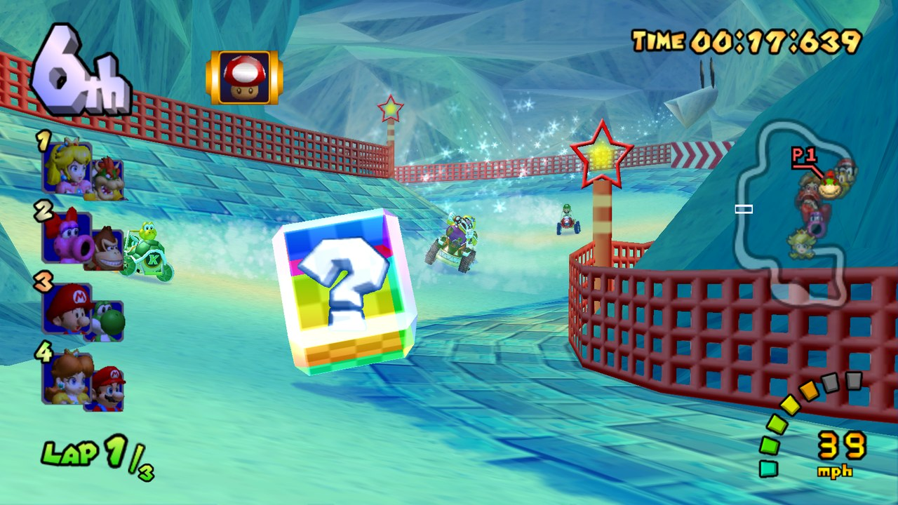
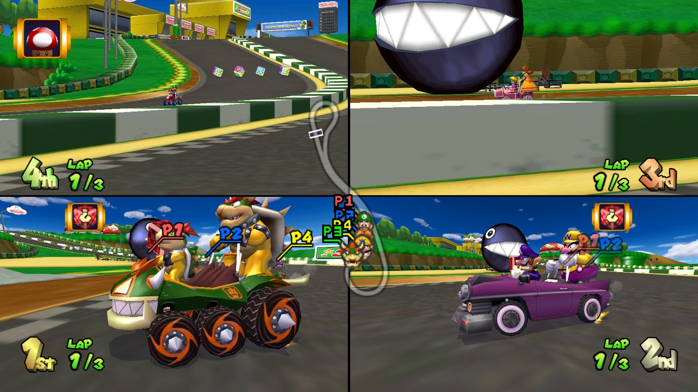
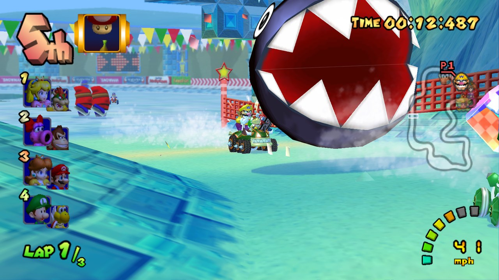
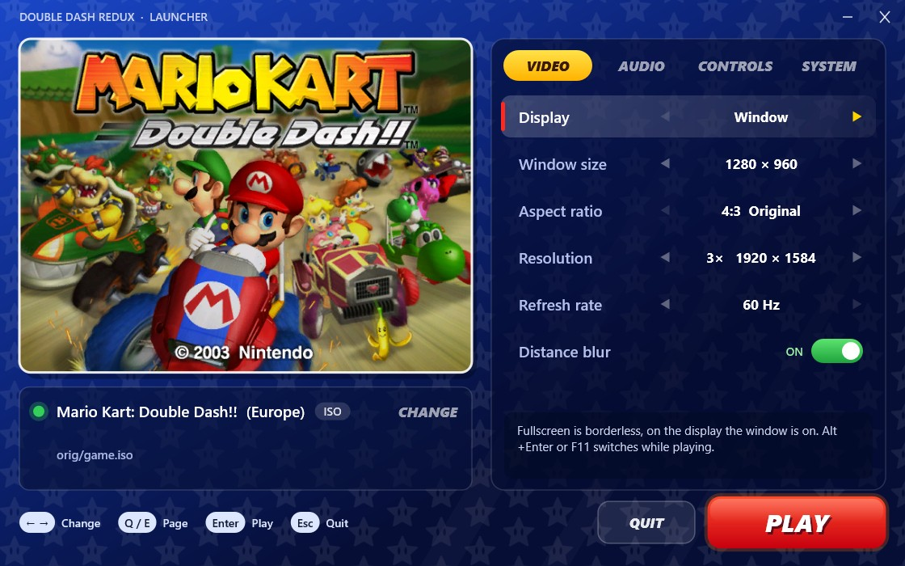

<p align="center">
  
</p>

<p align="center">
  <b>Mario Kart: Double Dash!! as a native Windows game.</b><br>
  No emulator: the GameCube's PowerPC code is statically recompiled to C++ and runs directly on your PC.
</p>

<p align="center">
  <a href="https://github.com/Jaster111/double-dash-redux/releases/latest"></a>
  
  
  <a href="LICENSE"></a>
</p>

<p align="center">
  <a href="#-quick-start">Quick start</a> •
  <a href="#-features">Features</a> •
  <a href="#-controls">Controls</a> •
  <a href="#-building-from-source">Building</a> •
  <a href="#-how-it-works">How it works</a> •
  <a href="#-faq">FAQ</a>
</p>

<p align="center">
  
</p>

> [!IMPORTANT]
> Double Dash Redux contains **no game data**. You need your own disc image of
> **Mario Kart: Double Dash!! (Europe, game ID `GM4P01`)**, for example dumped from your own disc with Dolphin.

---

## ✨ Features

|   |   |
|---|---|
| 🏁 **The whole game** | Grand Prix (all cups, 50cc to Mirror and the All-Cup Tour), Time Trials with ghosts and staff ghosts, Versus, all three battle modes, award ceremonies, the opening movie and the staff roll. |
| 🖥️ **High resolution** | Internal resolution from 1× to 8× the GameCube's 640×528, so 4K is possible, in a window or borderless fullscreen (<kbd>Alt</kbd>+<kbd>Enter</kbd> / <kbd>F11</kbd>). |
| 📺 **16:9 widescreen** | A true widescreen view in races, with the HUD at the screen edges, from the well-known *16:9 Widescreen v2* code (Ralf & Kester). |
| ⏱️ **60 Hz** | The PAL release's 60 Hz mode is preselected at boot; 50 Hz is still there. |
| 🎮 **4-player split screen** | Up to four Xbox-style (XInput) controllers with rumble, plus keyboard controls for player 1. |
| 💾 **Dolphin-compatible saves** | The memory card is a Dolphin `.raw` image, so you can move saves between Double Dash Redux and Dolphin. |
| 📀 **ISO and RVZ** | Reads `.iso` / `.gcm` images and Dolphin's compressed `.rvz` directly. The disc is checked so that a wrong or modified image is refused with a clear message. |
| 🌫️ **Optional distance blur** | The courses' depth blur and heat shimmer work as on the console. You can turn them off for a sharp picture. |
| 🚀 **Launcher** | A settings window before the game starts. It works with the mouse, the keyboard or a controller. |

<p align="center">
  
  
</p>

<details>
<summary><b>📸 More screenshots</b> (16:9, 1280×720)</summary>
<p align="center">
  
  
  
  
</p>
</details>

## 🚀 Quick start

1. **Download** the latest `DoubleDashRedux-*.zip` from [Releases](https://github.com/Jaster111/double-dash-redux/releases/latest).
2. **Extract** it to a folder you can write to (not *Program Files*). Settings, saves and the shader cache are kept next to the exe.
3. **Add your disc image**: put the `.iso`, `.gcm` or `.rvz` in the same folder, or pick it in the launcher (*SYSTEM → Game disc*).
4. **Run `DoubleDashRedux.exe`**, choose your settings and press **PLAY**.

**Requirements:** Windows 10 or 11 (64-bit), a Direct3D 11 graphics card and any reasonably modern x64 CPU.
4-player split screen is the most demanding mode.

<details>
<summary><b>My disc image is .wia, .gcz or .ciso</b></summary>

Convert it in Dolphin: right-click the game → *Convert File…* → set *Format* to **RVZ** or **ISO** → *Convert*.
</details>

<details>
<summary><b>I have the North American or Japanese release</b></summary>

Not supported yet. The recompiled code comes from one exact executable, the European `GM4P01` release.
The launcher tells you which release it found.
</details>

## ⚙️ Settings

<p align="center">
  
</p>

The launcher saves every change at once to `settings.ini`. You can also edit that file by hand: it is created with comments on the first start.

| Setting | Default | What it does |
|---|---|---|
| `video.fullscreen` | `0` | Borderless fullscreen on the display the window is on |
| `video.window_width` / `window_height` | `1280` / `960` | Window size |
| `video.internal_scale` | `3` | Internal resolution, 1-8 × 640×528 |
| `video.widescreen` | `0` | 16:9 widescreen |
| `video.pal60` | `1` | Offer 60 Hz at boot (`0` = 50 Hz only) |
| `video.depth_blur` | `1` | Distance blur and heat shimmer |
| `audio.volume` / `audio.mute` | `100` / `0` | Master volume (%) / no sound |
| `input.rumble` / `rumble_strength` | `1` / `100` | Controller rumble and its strength (%) |
| `launcher.show` | `1` | Show the launcher at start. Hold <kbd>Shift</kbd> while starting to bring it back. |
| `memcard.slot_a` / `slot_b` | `saves/MemoryCardA.raw` / `none` | Memory card images |
| `game.disc` | *(empty)* | Disc image path. Empty means "look next to the exe, or ask". |

The exe also takes command-line options: `--play` skips the launcher once and `--launcher` shows it once.

## 🎮 Controls

| GameCube | Xbox controller | Keyboard (player 1) |
|---|---|---|
| Control stick | Left stick | Arrow keys / <kbd>W</kbd><kbd>A</kbd><kbd>S</kbd><kbd>D</kbd> |
| A | A | <kbd>Space</kbd> / <kbd>X</kbd> |
| B | B | <kbd>Z</kbd> / <kbd>Backspace</kbd> |
| X | X | <kbd>C</kbd> / <kbd>Ctrl</kbd> |
| Y | Y | <kbd>V</kbd> |
| L | LT (analog) | <kbd>Q</kbd> |
| R | RT (analog) | <kbd>E</kbd> / <kbd>Shift</kbd> |
| Z | LB or RB | <kbd>F</kbd> / <kbd>Tab</kbd> |
| Start | Start or Back | <kbd>Enter</kbd> / <kbd>Esc</kbd> |
| D-pad | D-pad | <kbd>I</kbd> <kbd>J</kbd> <kbd>K</kbd> <kbd>L</kbd> |

<kbd>Alt</kbd>+<kbd>Enter</kbd> or <kbd>F11</kbd> toggles fullscreen and <kbd>Alt</kbd>+<kbd>F4</kbd> quits.
PlayStation, Switch and other controllers work through Steam Input or a tool such as DS4Windows, which present them as Xbox controllers.

## 🔨 Building from source

**You need:** Visual Studio 2022 or newer with *Desktop development with C++*, CMake 3.20+, Python 3.8+ and your `GM4P01` disc image.

```powershell
git clone https://github.com/Jaster111/double-dash-redux.git
cd double-dash-redux
powershell -ExecutionPolicy Bypass -File tools\build.ps1 -Disc "D:\Games\Mario Kart Double Dash (Europe).rvz"
```

The first build takes a few minutes. It:

1. extracts `main.dol` from your disc image and checks it against the expected CRC32 (`tools/dolextract`),
2. recompiles it into about 13,500 C++ functions in `build/recomp/` (`tools/recomp/recomp.py`),
3. compiles the runtime and the generated code into **`out\Release\DoubleDashRedux.exe`**.

After that, `tools\build.ps1` only recompiles what changed. Use `-Recomp` to run the recompiler again after editing
`tools/recomp/`, `runtime/hle_functions.txt` or `runtime/patches/`. `tools\package.ps1` builds the release zip in `dist\`.

<details>
<summary><b>Developer tools</b></summary>

- `tools\run.ps1` builds, runs the game for a limited time and prints the log tail. With `-Script` it plays a scripted
  controller input file from `tools/scripts/`, e.g. `gp_quit.txt`, a GP race → pause → quit regression test.
- `-Autopilot on` lets the game's AI drive the players' karts. The test scripts use it to play through whole cups, battles and Time Trials.
- `tools/sym.py` annotates guest addresses in `DoubleDashRedux.log` with function names.
- `DD_*` environment variables control debug features: profiler, hang detector, GX probes, audio dump and more.
  See the headers of `runtime/host/debug.cpp` and `tools/run.ps1`.
- `tools/wsl/` and `tools/match_map.py` hold the original analysis pipeline (Ghidra + REA in WSL, plus a link-map match).
  Its result is committed as `tools/recomp/functions.txt`, so a normal build does not need it.
</details>

## 🧠 How it works

```
 disc image ──► main.dol ──► recomp.py ──► C++ (one function per guest function) ─┐
  (.iso/.rvz)    (PowerPC)                                                         ├─► DoubleDashRedux.exe
                                      runtime: CPU state, OS, GX → D3D11, DSP audio ┘
```

- **Static recompiler** (`tools/recomp/`) translates every PowerPC (Gekko) instruction of `main.dol` into C++, including
  paired-single floating point. Jump tables and function pointers are resolved ahead of time, and a few SDK functions are
  replaced by native code (`runtime/hle_functions.txt`).
- **Graphics** (`runtime/gx/`): the game's GX command stream is decoded and drawn with Direct3D 11. TEV stages become
  generated pixel shaders, and EFB copies, fog and indirect textures are all handled. Draws are batched and shaders are
  cached on disk.
- **Audio** (`runtime/audio/`): a high-level implementation of the DSP "Zelda" microcode the game uses, ported from Dolphin, played through XAudio2.
- **Hardware** (`runtime/hw/`): video interface timing, controllers, memory cards, disc drive and interrupts. Game assets
  are streamed straight from your disc image.
- **Patches** (`runtime/patches/`): Gecko codes such as the widescreen hack are compiled into the binary and can be switched on and off at runtime.

## 📋 Status

The game is playable from start to finish. Automated runs have covered all 16 courses (normal and mirror), the
All-Cup Tour with its award ceremony and staff roll, 2- and 4-player Versus, all six battle arenas in every battle mode,
saving and loading records and ghosts, and the opening movie.

Known issues:
- In 16:9, some menus show bits of off-screen graphics at the left and right edges, as they do in Dolphin with the same code.
- A thin seam is visible on the rotating Grand Prix laurel in the mode-select menu.
- LAN play (Broadband Adapter) is not supported.
- Only the European release is supported.

Found something else? Please [open an issue](https://github.com/Jaster111/double-dash-redux/issues) and attach
`DoubleDashRedux.log` from the game folder.

## ❓ FAQ

**Is this an emulator?**
No. There is no CPU interpreter or JIT: the game's code is translated to C++ once, at build time, and compiled like any
other program. The runtime only provides what the GameCube's hardware and OS used to provide.

**Does it include the game?**
No. You need your own copy. The repository and the releases contain only original code plus a list of function addresses and
names, and the game's code and assets are read from your disc image.

**Why only the European version?**
Every release has a different `main.dol`, and the recompiled code and its patches are tied to one exact build.

**Linux / macOS?**
Not yet: the runtime uses Direct3D 11, XAudio2 and XInput. It may run under Wine/Proton, but that is untested.

## 🙏 Credits

- [Dolphin](https://dolphin-emu.org/): Double Dash Redux's DSP audio renderer is a port of Dolphin's Zelda microcode HLE,
  and Dolphin's documentation of the GameCube hardware was essential.
- **Ralf** and **Kester** for the *16:9 Widescreen v2* code and its menu-backgrounds add-on.
- The [Mario Kart: Double Dash!! decompilation](https://github.com/SwareJonge/mkdd) project, for reference on the game's internals.
- [Zstandard](https://github.com/facebook/zstd) (BSD) for RVZ decompression, and [nod](https://github.com/encounter/nod) (`nodtool`) for disc tooling.
- [Ghidra](https://ghidra-sre.org/) and Cuyler36's [GameCube loader](https://github.com/Cuyler36/Ghidra-GameCube-Loader) for the analysis that seeded the function list.

## ⚖️ Licence

Double Dash Redux is free software: you can redistribute it and/or modify it under the terms of the
[GNU General Public License](LICENSE), version 2 or (at your option) any later version.
`third_party/zstd` is under its own BSD licence.

*Mario Kart: Double Dash!!* is © 2003 Nintendo. Double Dash Redux is a fan project, is not affiliated with or
endorsed by Nintendo, and does not include any of Nintendo's code or assets.
